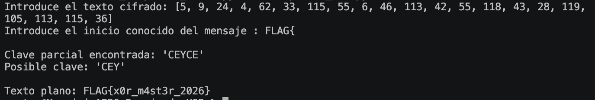

# AP20 – Rompiendo XOR

## Objetivo

El objetivo de este ejercicio es recuperar un mensaje cifrado mediante XOR y descubrir la clave utilizada para cifrarlo.

Sabemos que todos los mensajes del grupo comienzan por:

`FLAG{`

Esta pista permite obtener los primeros caracteres de la clave y utilizarla después para descifrar el mensaje completo.

---

## Texto cifrado

```text
[5, 9, 24, 4, 62, 33, 115, 55, 6, 46, 113, 42, 55, 118, 43, 28, 119, 105, 113, 115, 36]

---

## Captura de la ejecución

La siguiente captura muestra la ejecución del programa, donde se recupera la clave utilizada y el texto plano original.

